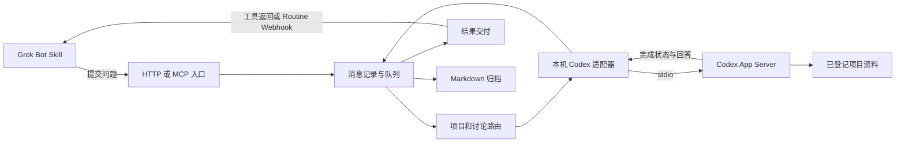

# AgentRoom 系统设计

设计日期：2026 年 10 月 11 日。本文件保留最初设计提议；当前已实现和未验收的范围以 [交付状态](IMPLEMENTATION_STATUS.md) 和 [使用说明](USER_GUIDE.md) 为准。

用户明确要求全程后台交互。通信、触发、查询和回报不得通过 Computer Use、模拟键鼠或切换应用完成。当前后台检查结果见 [后台交互检查](BACKGROUND_INTERACTION.md)。

Grok Bot 负责运营任务，Codex 负责核实项目事实。AgentRoom 负责找到对应讨论、启动处理、交付回答和保留证据。目标是让用户只需交代任务，追问和回报沿同一条讨论继续。

## 用户流程

1. 一次性登记真实项目路径、Codex 讨论策略和 Grok Bot 返回入口。
2. 告诉 Grok：“运营这个项目，有项目疑问通过 AgentRoom 询问 Codex。”
3. Grok 读取项目资料，遇到未确认信息时提交问题。
4. 当前讨论已有 Codex 绑定就继续；首次讨论创建专用聊天并绑定。
5. 回答返回当前工具调用；若本轮已结束，通知固定 Grok Routine 领取结果。
6. 追问沿用讨论 ID；不同项目或独立任务使用新的讨论 ID。

原生 UI 必须可追踪：用户能找到对应 Codex 聊天，能在 Grok 的原对话或明确的接收 Routine 中看到关联结果。若只能恢复逻辑任务而不能续接原聊天，界面必须明确说明回报去向。

## 组件



接收程序建议使用 TypeScript/Node；SQLite 保存队列和绑定；Markdown 保存消息正文与阅读记录。组件可在同一个本机进程中，公网可达入口按网络验证结果配置。程序等待期间不调用模型。

第一版采用本机部署，不购买服务器、不部署自有公网消息或回调服务。Grok 通过已授权的本机命令工具调用 AgentRoom CLI，本地 CLI 与后台进程通信并返回结果；Codex 在同机处理。需要唤醒 Grok 时使用其平台已有的 Webhook，结果由其本机工具领取或写入固定讨论记录。若目标 Bot 缺少本机命令能力，则标为第一版不支持，不以搭建公网转发作为默认补救方案。

## 聊天室与项目

本系统使用用户选定的工作目录；第一版复用该目录已登记的桌面项目，不自动重命名。文档中的目录与项目引用仅为说明，真实绝对路径及项目 ID 应在本机登记。

产品中的“聊天室”是用户可见的组织入口，每条讨论仍绑定真实业务项目。桌面 project、侧边栏 section、App Server cwd、逻辑讨论 ID 是四个不同对象。

可以选择在已有项目下显示聊天，或验证后加一个名为“聊天室”的 section。当前本机协议支持 section 方法，但它不能代替项目归属接口。程序创建聊天是否自动显示在已有项目下，必须通过桌面观察验收。

## 对话绑定

绑定主键为 `(owner_id, project_key, discussion_id, target_agent)`，记录 Codex thread ID、Grok Bot 接收端、来源对话引用和绑定代次。显示名称仅用于查找，不能做唯一主键。

| 情况 | 处理 |
| --- | --- |
| 从未建立绑定 | 在事务中领取创建权，创建一次聊天，持久化返回 ID |
| 已有有效绑定 | 读取并恢复该 ID，再提交一轮处理 |
| 对话正在处理 | 同讨论排队；保持当前任务；默认不插入 `turn/steer` |
| 对话被其他进程占用或无法访问 | 保留问题并报具体状态，不创建替代聊天掩盖失败 |
| 已确认删除 | 按用户设置决定重建，记录旧 ID、原因及新代次，附上摘要 |
| 已归档 | 遵循已登记策略；默认等待用户决定，不自动解档 |
| 标题相同但存在多个候选 | 使用既有绑定；首次接入需选定，不能取“最近一条” |

线程创建是外部副作用：先记录 creation intent。若响应丢失，进入 `creation_uncertain`；通过事前关联标记和可用元数据查找。未能唯一找到时停在待协调状态，不能立即再创建。仅本地数据库锁不足以保证跨进程绝对一次创建。

## Codex 适配器

第一版由接收程序持有独立 App Server 的 stdio 连接，不让云端直接连接桌面内部端点。

1. `initialize` 和 `initialized` 建立协议连接。
2. 使用已登记路由，执行 `thread/start` 或 `thread/resume`。
3. 创建后用 `thread/name/set` 命名，例如“项目 A 的 X 运营问答”。
4. `turn/start` 提交带来源标记的问题，保存 thread ID 与 turn ID。
5. 收集回答，等待执行完成事件；成功、失败、取消分别记录。
6. 回答和交付队列在同一事务中提交，再生成 Markdown。

模型沿用用户设置；问题只读核查时采用只读项目访问，具体可读范围须实测。当前本机 `ThreadStartParams.sandbox` 的值是 `read-only`，不同于 `turn/start.sandboxPolicy` 的对象结构。SDK/绑定必须与安装版本的 schema 对齐。

不得为了连接方便改写用户全局 Codex 配置。接收程序启动的工作会话是否加载 MCP、插件、hooks，以及审批提示如何返回，均在执行验证时检查；要求人工处理时返回 `needs_user_input`。

专用讨论避免接管正在开发的聊天。读取桌面聊天元数据不证明能安全写入该聊天；若后续绑定开发会话，必须验证所有者、占用及上下文边界。

## 项目事实

登记表决定真实代码与资料位置。AgentRoom 自身目录不天然包含其他项目事实。源项目可以有未提交代码，回答应区分当前工作树、已验证内容、已发布版本和设想。

建议开发 Codex 维护一份项目说明和发布事实清单，包含版本或时间、功能状态、公开链接和素材路径。项目问答 Codex 根据登记资料核实，无法验证时明确回复“不确定”，不把“代码存在”直接当成“已上线”。

如果知识只存在于开发对话，需显式提供摘要或接入授权的开发会话；项目问答聊天不会自动继承别的聊天记忆。

## Grok 返回路径

优先采用以下顺序：

1. **当前调用仍在等待**：通过工具结果直接返回。短等待超时则给请求 ID，后续查询不会重跑 Codex。
2. **已结束本轮**：调用已登记 Bot 的 Routine Webhook，传递 discussion ID 和 result ID，由 Routine 领取结果并确认消费。
3. **原生对话续聊**：仅在实测具备指定对话投递能力后启用。保存来源引用不代表平台一定支持恢复。

返回方式要在提交时约定为一种主路径。不要同时把工具结果和 webhook 都当成新运营命令，造成重复执行。Routine 收到通知后只领取未消费结果；回执区分“已收”“已消费”“已继续任务”。

Webhook HTTP 2xx 只表示请求被入口接受。Codex 已完成、Grok 已处理、原聊天已续接必须分别有证据。

如果没有可用 Grok 会话，默认使用一次性登记的协作接收 Bot/Routine，并以讨论记录重建任务状态。它是可用降级方案，不等同于程序新建了 Grok 原生聊天。自动创建 Grok Bot 或聊天保留为后续能力。

## 文件与状态

建议未来布局：

```text
AgentRoom/
  docs/                         # 本轮设计与研究证据
  examples/                     # 虚构协议示例
  src/                          # 后续接收程序，当前不存在
  config/                       # 项目登记及策略，不包含凭据
  data/room.sqlite              # 路由、消息、运行、交付状态
  rooms/<room-id>/messages/      # 不可变 Markdown 正文
  rooms/<room-id>/receipts/      # 各接收者独立回执
  rooms/<room-id>/summary.md     # 可重建摘要
```

SQLite 是调度与去重的权威状态，MD 是正文及可恢复归档。先事务入库，后由 outbox 写 MD；写临时文件再改名。导出失败不触发模型重跑，程序重启补导出。两个 agent 不共同追加一个无限增长的聊天文件。

直接写 MD 可作为本机输入适配器，但目录扫描必须处理消息 ID 去重、半写文件、非法路径和收件权限。云端 Grok 默认经 MCP/HTTP 提交，由接收程序落盘，避免整库同步和 Git 冲突。

## 可靠性与使用边界

每个 Codex 讨论一次只运行一轮，第一版总执行并发为 1。超时后先查询已知运行状态；未经确认不重跑模型。进程在模型完成和记录提交之间崩溃时，先恢复对话证据，仍无法确定则标记不确定结果。

消息授权映射到固定项目和接收者；入站正文不能指定任意本机路径、命令或回调地址。凭据留在凭据存储中，日志及 Markdown 不包含 webhook key、token 或带凭据 URL。保留可查看的来源与操作记录。

讨论轮数初始建议为 6，超出后总结未决事项；问答仅在确有新信息需求时继续。X 发布依赖用户对 Grok 的运营授权，不通过 AgentRoom 自动扩张权限。普通回报、回执和失败通知不自动生成新的提问。

## 实现顺序

先证明网络和两个平台的实际返回行为，再做队列与专用对话绑定。随后加入 Markdown 导出、Skill、桌面显示与恢复处理。完整验收见 [验证计划](VALIDATION_PLAN.md)。本轮不启动服务或新增配置。
