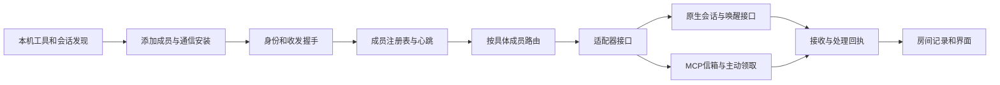

# 现有方案调研与 AgentRoom 下一版接入设计

> 本文件保留调研与设计背景。当前已完成的聊天室核心、真实 Codex 协作及尚未完成的 Grok 原群验收，以 [0.2 交付状态](CHAT_RELEASE_STATUS.md) 为准。

调研日期：2026-10-11。按用户要求，先检查已有项目再选择实现路线。本次读取了项目 README、许可证元数据，以及 Concord 的客户端能力目录、安装器、Claude hooks 和 monitor 源码。没有运行这些项目的安装脚本或更改用户的客户端配置。

## 结论

这个方向已经有可借鉴的实现。最接近我们需要的组合是 **Concord 的适配器生命周期 + add-mcp 的客户端配置接入 + 会话注册和持久消息机制**。AgentRoom 的区别应当是 Windows 上简单的“发现、添加、验证”体验，以及用户原有工作会话的协作，而不是再做一套需要用户背命令的聊天转发器。

当前 0.1 的接收方在 `src/store.cjs`、`src/service.cjs`、`src/mcp.cjs` 和前端中写成 Codex/Grok 两项，也只有一个主要执行队列。这确实限制了添加新 agent；需要从数据模型和路由层改起，增加一个 Claude 按钮不足以解决问题。

## 借鉴对象

| 项目 | 检查到的能力 | 适合借鉴的部分 | 使用前需要处理的边界 |
| --- | --- | --- | --- |
| [Concord MCP](https://github.com/Get-Concord-AI/concord-mcp) | 多客户端配置、适配器状态、消息与回复；Claude 原生 monitor 和 hooks | 安装/诊断/卸载生命周期；分别描述空闲和忙碌时的送达能力 | 安装后已有会话需要加载插件；不能把安装成功当成消息处理成功。其 Grok Build 接法不等于 Grok Bot |
| [add-mcp](https://github.com/neon-solutions/add-mcp) | 检测已安装客户端，写入多种 MCP 配置格式 | 接入配置目录、配置合并、客户端清单 | 负责配置，不负责唤醒和运行 agent；各客户端仍有重载或信任条件 |
| [agent-peers-mcp](https://github.com/Co-Messi/agent-peers-mcp) | 本机会话发现、心跳、持久消息与确认 | 会话身份、租约、离线与重连、确认后才移除消息 | 普通 Codex MCP 会话不能自动开启新一轮，需专门的可唤醒执行器 |
| [agent-bridge](https://github.com/raysonmeng/agent-bridge) | Claude channel 与 Codex App Server 双向通信 | 原生会话路由、来源标记和回路防护 | README 明确 Windows 尚未正式支持；当前按 Claude/Codex 配对，不能直接作为任意成员房间 |
| [open-agent-bridge](https://github.com/kevinArgueta96/open-agent-bridge) | 多客户端注册、MCP 身份、统一消息与回执 | 会话注册表、传输与产品类型分离 | README 列有本机 API 无认证、部分注册状态易失等限制，需要独立修正和验证 |
| [agent-loom](https://github.com/osteele/agent-loom) | 本机持久信箱、线程、回执与 MCP 接入 | 发出、读取、处理等独立回执 | 通用 MCP 接入不等于自动推送；实时收信依赖客户端集成 |

以上除 add-mcp 为 Apache-2.0 外，检查到的许可证元数据为 MIT。这里借鉴的是结构与机制，尚未复制第三方代码。如果后续引入代码或依赖，需要保留相应许可证和来源，并固定版本。

[Agent Relay Desktop](https://desktop.agent-relay.dev/faq) 的发现本机 CLI、沿用现有订阅和统一界面也值得参考，但其官方桌面发行目前仅支持 Apple Silicon macOS，不是当前 Windows 目标的直接替代。

`agent-discover` 名字容易混淆：其核心是发现和管理 MCP 工具服务器，不是发现正在工作的 agent 会话，因此不作为我们的协作核心。

## Claude 接入发现

Claude 有两种可研究的原生推送路径：

- Channel：MCP 服务器通过声明能力推送事件；自建 channel 目前有预览开关、组织策略和启动时确认条件。[官方说明](https://code.claude.com/docs/en/channels-reference)
- Plugin monitor：交互会话中持续运行插件后台命令，配合生命周期 hooks。Concord 采用这种结构；官方 manifest 说明 monitor 在会话启动或插件重载时启动，并列出了交互会话及供应商限制。[官方说明](https://code.claude.com/docs/en/plugins-reference#monitors)

因此不能宣称只装一个 MCP 就一定能唤醒所有 agent，也不能仅依据进程存在宣称已经接管其当前对话。选哪一种原生推送必须经过本机版本、登录方式、会话状态和实际收发探测。

本次本机检查找到了 Codex 和 Grok Bot 的进程，没有发现可执行的 Claude Code CLI 或对应进程。这是当前快照，不意味着未来打开 Claude 后仍不可发现；也不能据此宣称 Claude 接入已实测。

## 下一版的用户体验

侧栏新增“成员”和“添加 agent”，不再把 Codex/Grok 作为界面固定入口。

1. 点“添加 agent”，显示本机已发现的工具和已注册的具体会话。候选项包含名称、所属项目、是否正在运行以及接入条件。
2. 选择例如“Claude Code · 产品前端项目”。添加操作授权为这个客户端安装 AgentRoom 通信组件；界面先显示安装范围，保留已有配置和其他插件。
3. 程序根据适配器完成确定性的安装，再发送一次身份和通信握手。让 agent 返回其会话身份、项目范围和实际收到的随机校验值。
4. 收到匹配回报后，显示“已加入、可收发”。只有写完配置时显示“已安装、等待会话加载”；登录失败、版本不兼容等给出明确下一步。
5. 在房间里按成员名选目标或提及成员；消息发到选定会话。添加第二个 Claude 实例时保留两个独立成员，不因工具类型相同合并。
6. 会话结束后成员显示离线，消息保留；重连必须验证原身份或由用户明确选择替代会话。

如果宿主只能在重载后使用新插件，界面提供那一个必要操作，不能偷偷创建另一个会话再冒充已经连上原对话。用户可另选“在 AgentRoom 启动协作会话”，但它应明确是新的工作会话。

让 agent 协助判断项目事实有价值；安装配置、记录身份和判断握手是否成功应由软件确定性完成，避免要求模型临时编写一套通信安装脚本。

## 结构调整

核心约定：

- `AgentType`：产品类型及安装接法，例如 Claude Code；由适配器目录提供，核心不枚举接收方产品名。
- `AgentSession`：一次具体工作会话，包含稳定身份、项目、原生会话 ID、连接方式、心跳和验证记录。
- `RoomMember`：哪个会话加入哪个房间、显示名称和用户赋予的工作范围。
- `Adapter`：提供 `discover / inspect / install / connect / verify / send / cancel / uninstall`；未支持的操作必须返回明确能力限制。
- `Message`：以成员 ID 为收发对象，保留关联消息、讨论线程、幂等键和来源；不能依靠产品名称推断目标。
- `Receipt`：分别记录已入队、已送达、已消费、正在处理和实际回复。安装与握手状态不替代任务处理状态。

不同成员可以各自执行，避免 Codex 等待 Claude 回复时，Claude 也被堵在同一个全局执行队列里。成员自身的任务需要串行或按其原生并发约束调度。循环请求需要来源链、最大跳数和超时处理。

## “任何 agent” 的实现边界

未来增加兼容 MCP 的 agent，应能通过统一注册和信箱协议加入；新增原生自动唤醒能力，由独立适配器提供，不要求修改房间、消息、成员 UI 或核心路由。

MCP 通常提供工具调用，ACP/App Server 等控制接口提供会话操作，A2A 等协议描述和交换任务；这几层不能视为同一种能力。有封闭接口的工具仍可能需要厂家支持或一次性配置。产品可以统一接入流程，不能保证对任意未知应用自动操控已有对话。

## 验收要求

1. 新增另一个产品适配器时，核心接收方校验、消息路由和成员 UI 不出现新的产品名分支。
2. 新打开的兼容会话在发现列表里出现；已安装但没会话的工具显示为另一种状态。
3. 点击添加后保留用户已有配置；重复添加不重复安装；失败可重试而不重复发起任务。
4. 只有真实握手成功后显示可收发，实际问题和答案必须进入同一选定会话和房间线程。
5. 两个 Claude 会话可单独寻址；断线、过期心跳和重新连接可识别。
6. 验证 Claude → Codex → Claude 与 Codex → Claude → Codex，两端空闲和一端忙碌都测试；不以 webhook HTTP 成功或进程启动代替实际回报。
7. 不模拟键鼠，不切换用户窗口，不改写整个客户端配置，不授予任意 peer 消息额外执行权限。

上文是调研阶段的实现约定。0.2 已实现本地多成员聊天室和真实 Codex 协作；Claude 原生接入与 Grok 原群往返仍未列为已验收。
