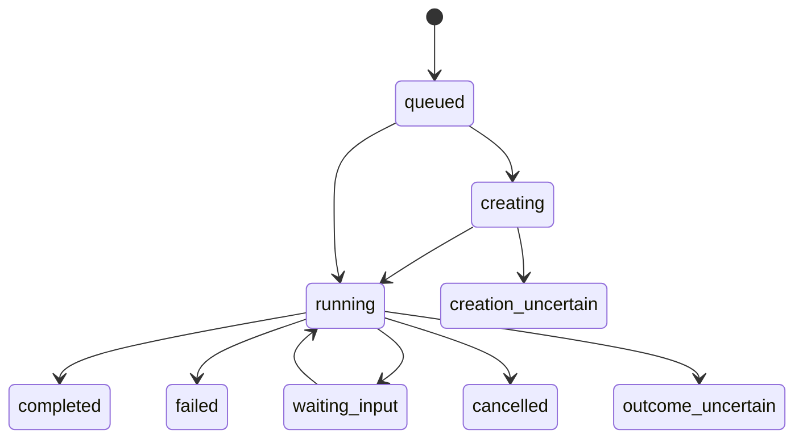

# AgentRoom 消息协议草案

版本：设计草案 0.1。此处的接口是拟实现的 AgentRoom 接口，不是 Codex 或 Grok 的官方 API。

一次讨论有稳定的 discussion ID，一次提问有稳定的 request ID，一次执行有运行 ID，一次结果交付有 delivery ID。保持这些对象分离，才可以继续讨论而不重复执行。

## 消息字段

| 字段 | 含义 |
| --- | --- |
| `protocol_version` | 固定为 `0.1` |
| `message_id` | 接收程序分配的唯一消息 ID |
| `idempotency_key` | 发起方为同一次逻辑请求保存的重试键 |
| `project_key` | 已登记业务项目标识 |
| `discussion_id` | 持续讨论标识；首次由程序分配 |
| `sender`、`recipient` | agent 身份；程序依据认证验证，正文声明不授予身份 |
| `type` | `question`、`answer`、`result`、`status`、`receipt` |
| `reply_to` | 回答所对应的消息 ID，可为空 |
| `created_at` | RFC 3339 时间，存储带时区时间；界面按 Asia/Taipei 显示 |
| `subject` | 人可读主题，不用于唯一匹配 |
| `source_conversation_ref` | 可选平台来源引用；未取得时为空，不能猜测 |
| `delivery_mode` | `tool_result` 或 `routine_notification` |
| `body` | Markdown 正文 |

认证主体、project key、idempotency key 组成去重键。相同键和相同正文返回既有请求；相同键但正文不同返回冲突，不能默默替换原消息。

提问正文包含问题、已查资料和需要的证据。回答包含可核实事实、资料位置或公开链接、核查时间、未知项及结论。不要在消息中保存登录信息或让项目事实变成执行权限。

## MCP 工具与 HTTP 草案

| MCP 名称 | HTTP 对应 | 行为 |
| --- | --- | --- |
| `agentroom_submit` | `POST /v1/requests` | 持久化并排队，返回请求 ID 和讨论 ID |
| `agentroom_result` | `GET /v1/requests/{id}` | 读取当前状态和已生成结果，不触发重跑 |
| `agentroom_wait` | `GET /v1/requests/{id}/wait` | 有界等待，超时仍保留原请求 |
| `agentroom_history` | `GET /v1/discussions/{id}` | 分页返回该讨论内容 |
| `agentroom_ack` | `POST /v1/deliveries/{id}/ack` | 记录领取、消费或任务继续的回执 |
| `agentroom_cancel` | `POST /v1/requests/{id}/cancel` | 请求停止，结果与实际运行状态分别记录 |

项目登记、凭据绑定、对话迁移、重建策略是管理操作，不作为运营 Skill 的普通工具。运行者不能提交任意 `cwd`，由服务端登记表决定读取哪个项目。

`agentroom_wait` 初始建议最长 25 秒；客户端单次调用限制更低时进一步缩短。返回 pending 后查询原 ID。模型运行超时初始建议 5 分钟，超过只停止等待并协调执行状态，不直接启动第二次。

## 提交示例

```json
{
  "protocol_version": "0.1",
  "idempotency_key": "demo-question-001",
  "project_key": "demo-product",
  "discussion_id": "discussion-demo-x-ops",
  "recipient": "codex-project",
  "type": "question",
  "subject": "离线模式是否可以宣传",
  "delivery_mode": "tool_result",
  "source_conversation_ref": null,
  "body": "请核实离线模式是否已发布，指出支持范围和依据。"
}
```

首次无讨论 ID 可省略该字段，由服务返回新的 ID；之后必须沿用返回值。示例 discussion ID 已假设登记，不能在真实调用中把它当成现有讨论。

受理响应的 `accepted` 只表示消息已持久化：

```json
{
  "request_id": "request-demo-001",
  "discussion_id": "discussion-demo-x-ops",
  "accepted": true,
  "execution_status": "queued",
  "delivery_status": "pending"
}
```

## 执行与交付状态

执行状态：



`creation_uncertain` 和 `outcome_uncertain` 需要查证后转换为已知状态或保持等待。网络超时、未知进程退出、用户输入待答不能统一当作 failed 后重跑。

交付状态单独记录：`pending` → `notifying` → `accepted` → `consumed` → `continued`。通知失败为 `delivery_failed`，重试交付已保存结果，不重新运行 Codex。

- `completed`：收到成功的执行完成状态，并保存完整回答。
- `accepted`：工具响应已交给客户端，或 webhook 返回受理成功。工具响应也不保证模型已经阅读它。
- `consumed`：接收方显式确认已读取并处理该 delivery ID。
- `continued`：接收方确认原运营任务已继续，附上来源引用或任务记录。

若 Grok 只能在接收 Routine 中恢复任务，另标记 `native_conversation_status: "not_verified"` 或 `"fallback"`。只有原聊天中观察到对应结果，才标记 `"verified"`。

## Grok 通知正文

```json
{
  "event": "agentroom.answer_ready",
  "request_id": "request-demo-001",
  "discussion_id": "discussion-demo-x-ops",
  "delivery_id": "delivery-demo-001",
  "project_key": "demo-product",
  "source_conversation_ref": null,
  "action": "通过已安装的 AgentRoom 工具领取结果并回执"
}
```

这是我们发送给已配置 Routine 的业务 payload。字段不宣称是 Grok 官方的对话路由参数。通知只唤醒接收流程，不携带自动发布命令。Bot 可通过 `agentroom_result` 获取受其身份授权的完整回答。

通知重复时使用同一 delivery ID；接收方若已消费，返回回执而不再次执行运营动作。通知源和 result ID 必须核对，避免把其他项目回答送入当前任务。

## Markdown 读写

- 一个完整消息一个文件，YAML frontmatter 保存字段，正文保存 body。
- 文件名由服务生成的 message ID 决定；客户端 subject 和项目名称不直接作为文件路径。
- 原消息不可变。回复创建新文件，回执写到接收者自己的 receipts 目录。
- 服务端先入库，再导出；MD 缺失时由 outbox 重建。
- 手工或 agent 投入的文件先进入 staging，完成校验后导入；只有 `.md` 完整文件参与扫描，忽略 `.tmp`。
- 摘要可更新，但必须保留所覆盖的消息范围，不替代历史。

示例见 [问题](../examples/request.md)、[回答](../examples/reply.md)、[项目与路由](../examples/routes.example.json)。

## 逻辑记录

以下是需要表达的记录，不要求各建一张表。第一版可以只用 discussions、requests、deliveries、outbox 四张物理表；项目登记放配置，绑定随 discussion 保存，消息和运行随 request 保存，回执随 delivery 保存。

| 表 | 主要约束 |
| --- | --- |
| `projects` | 固定 project key、已解析绝对路径、事实资料位置及访问范围 |
| `discussions` | owner 与项目内 discussion ID 唯一 |
| `bindings` | 每个讨论每个目标 agent 一个有效绑定，记录原生 ID 和代次 |
| `messages` | message ID 唯一；认证主体内的重试键唯一，保存正文摘要 hash |
| `runs` | request ID、thread ID、turn ID、执行状态和租约 |
| `deliveries` | result ID、接收方、模式、尝试次数和状态 |
| `receipts` | delivery ID 与接收方去重，区分 consumed 和 continued |
| `outbox` | MD 导出与通知任务；可重试，不触发模型执行 |

重启后过期租约表示需要恢复协调，不表示远端执行已停止。先查运行证据，再决定重试。
